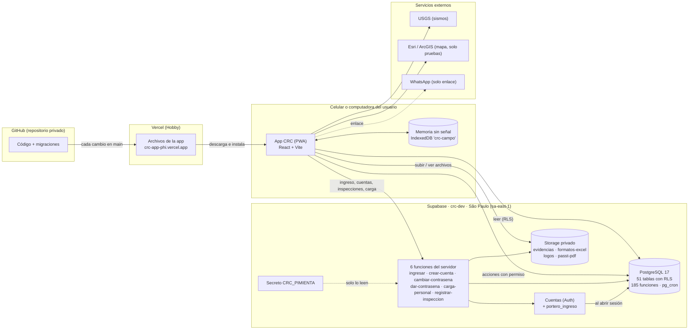
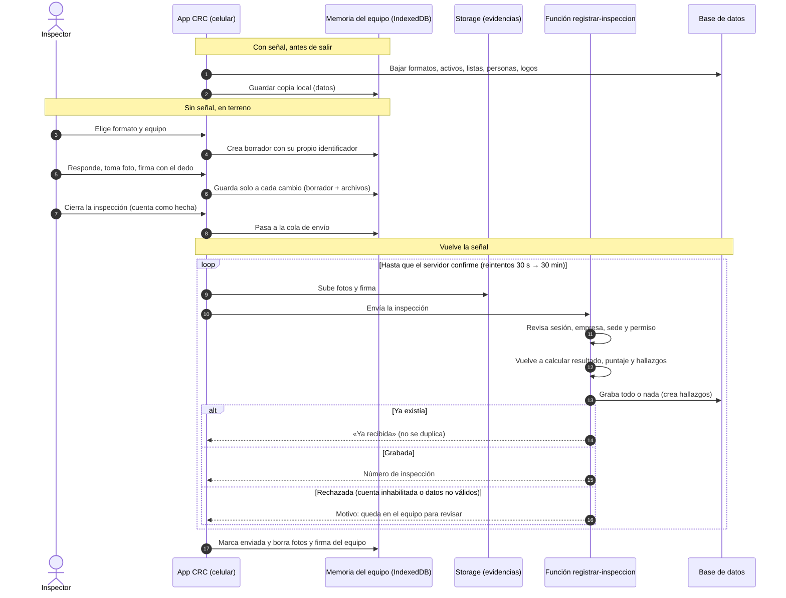

# Arquitectura de CRC · insumo para el documento oficial (ficha técnica)

- **Fecha:** 05/11/2026 · **Versión de la app descrita:** v0.9.6 (commit `df80b54`, publicada el 05/11/2026)
- **Fuentes:** el código del repositorio, la base de datos `crc-dev` (consultada **solo para leer**: nombres, conteos y configuración) y las notas del proyecto.
- **Reglas que se siguieron:** no se cambió nada del código ni de la base. No hay contraseñas, llaves, tokens ni valores de secretos: solo sus **nombres**. No se leyeron las carpetas 14 y 15 (contratistas y medio ambiente). Solo datos ficticios.
- Lo que no se pudo comprobar en el código o en la base dice **«por confirmar»**.

---

## 1. Resumen en 5 líneas

1. CRC (Centinel Risk Control) es un sistema de gestión de seguridad y salud en el trabajo (SST) para empresas clientes con una o varias sedes.
2. Es una **app web instalable en el celular (PWA)** hecha con React y Vite; abre y deja llenar inspecciones **sin señal**, y las envía sola cuando vuelve la conexión.
3. Todos los datos, las cuentas, los archivos y las funciones del servidor están en **Supabase** (base PostgreSQL, en São Paulo, Brasil).
4. La app **no escribe directo en ninguna tabla**: lee con reglas de seguridad por fila (RLS) que separan empresas y sedes, y todo cambio pasa por funciones que revisan permisos.
5. El código está en **GitHub** y cada cambio en la rama `main` lo publica **Vercel** de forma automática.

---

## 2. Piezas y tecnologías

| Pieza | Qué es y para qué | Versión | Región / ubicación |
|---|---|---|---|
| **App (frontend)** | React (pantallas) + Vite (armado) + TypeScript | React 19.3.1 · Vite 8.3.5 · TypeScript 6.0.3 | Corre en el navegador o el celular de cada usuario |
| **PWA (instalable y sin señal)** | `vite-plugin-pwa` con Workbox: guarda la app en el equipo y se actualiza sola | vite-plugin-pwa 2.0.0 · Workbox 7.4.1 | En el equipo del usuario |
| **Memoria sin señal** | IndexedDB del navegador (base `crc-campo`), con un envoltorio propio sin librerías | — (función del navegador) | En el equipo del usuario |
| **Base de datos** | Supabase · PostgreSQL, proyecto `crc-dev` | PostgreSQL 17 (17.11) | `sa-east-1` (São Paulo, Brasil) |
| **Cuentas de ingreso** | Supabase Auth, con un «portero» propio (`portero_ingreso`) | Incluido en Supabase | `sa-east-1` |
| **Funciones del servidor** | 6 *edge functions* de Supabase (Deno) | supabase-js 2.118.0 dentro de las funciones | **Por confirmar:** Supabase las corre en su red de borde; la región exacta no aparece en el código |
| **Archivos** | Supabase Storage: 4 depósitos privados | Incluido en Supabase | `sa-east-1` (mismo proyecto) |
| **Tarea programada** | `pg_cron` dentro de la base (borra intentos de ingreso de más de 90 días) | pg_cron 1.6.4 | `sa-east-1` |
| **Extensiones de la base** | `pgcrypto` 1.3, `uuid-ossp` 1.1, `pg_stat_statements` 1.11, `supabase_vault` 0.3.1, `plpgsql` | — | `sa-east-1` |
| **Publicación** | Vercel, plan Hobby (gratuito, **solo uso interno y no comercial**). Dirección pública: `crc-app-phi.vercel.app` | — | **Por confirmar** (Vercel sirve archivos fijos desde su red mundial; la app no tiene funciones en Vercel) |
| **Repositorio** | GitHub, repositorio **privado** `integraxmanagement-crypto/crc-app` | — | **Por confirmar** (GitHub no publica la ubicación física) |
| **Sismos (pantalla de inicio)** | Lista de sismos del servicio público del USGS (Servicio Geológico de EE. UU.) y enlace a la página del IGP (Perú) | — | Servicio de EE. UU. |
| **Mapa de sismos** | Mapa con Leaflet y teselas de **Esri / ArcGIS** (`server.arcgisonline.com`) | Leaflet 1.9.4 | Servicio de EE. UU. Según las notas, el mapa Esri es **solo para pruebas**: antes del piloto hay que elegir el servicio de mapas |
| **WhatsApp** | Solo un enlace `wa.me` al número corporativo que publica cada gestor (CRC no envía mensajes) | — | Servicio de terceros (Meta) |
| **Letra** | Archivo (Fontsource), **guardada dentro de la app** (no se descarga de Google Fonts) | 5.3.0 | En la app |
| **Íconos** | lucide-react | 1.61.0 | En la app |

Herramientas que solo se usan para construir (no viajan al usuario): Node.js 24 (en el equipo de desarrollo; el README pide 20 o más), oxlint 1.89.0 (revisión de código), `@vitejs/plugin-react` 6.1.2, `@vite-pwa/assets-generator` 2.0.0.

No se encontró en el código ningún servicio de analítica, publicidad, correo ni SMS.

---

## 3. Mapa de carpetas del repositorio

| Carpeta / archivo | Qué hay |
|---|---|
| `src/` | El código de la app (pantallas y lógica). Archivos sueltos: `App.tsx` (elige pantalla), `Ingreso.tsx`, `CambioContrasena.tsx`, `sesion.ts`, `supabase.ts` (conexión, solo clave pública), `ruta.ts` (navegación), `sedeActiva.ts`, `hooks.ts`, estilos. |
| `src/empresas/` | Registro de empresas: ficha, CIIU, sedes, contactos, logos, administradores, trabajadores. |
| `src/usuarios/` | Usuarios, estructura y puestos, contraseña nueva, «por revisar», restablecer en bloque y registro de intentos. |
| `src/carga/` | Carga de personal desde Excel (lector propio de .xlsx, plantilla, hoja de entrega). |
| `src/formatos/` | Formatos de inspección: receta, motor de reglas, plantillas base, constructor y prueba. |
| `src/activos/` | Activos, tipos, ubicaciones, listas y carga masiva de activos. |
| `src/inspecciones/` | Inspecciones en el celular: memoria sin señal, cola de envío, fotos, firma, Excel y PDF, avance por período. |
| `src/hallazgos/` | Seguimiento de hallazgos. |
| `src/passt/` | Programa anual de SST (PASST). |
| `src/solicitudes/` | Solicitudes de cambio del gestor y su aprobación. |
| `src/equipo/` | «Conoce al equipo de SST» (organigrama editable). |
| `src/inicio/` | Pantalla de inicio: avance, pendientes del mes, campana de avisos, emergencias, alerta de sismos. |
| `src/perfil/` | Perfil de la persona. |
| `src/marca/` | Logo oficial de CRC (SVG animado y estático). |
| `public/` | Íconos de instalación y del navegador (y un logo antiguo que ya no se usa). |
| `supabase/migrations/` | 64 archivos: cada cambio hecho a la base de datos, en orden. |
| `supabase/functions/` | Las 6 funciones del servidor y su código común (`_compartido/`: candado de contraseñas, reglas, motor de formatos). |
| `pruebas/` | 50 pruebas automáticas (`.mjs`) con cuentas ficticias, sus informes (`resultados/`), Excel ficticios (`excel/`) y notas para Cowork. |
| `herramientas/` | Generador de la migración de plantillas base y herramienta de rescate de la cuenta del dueño (solo si se pierde `CRC_PIMIENTA`). |
| `.claude/` | Configuración para abrir la app en modo prueba desde Claude Code. |
| `README.md`, `CLAUDE.md` | Manual del proyecto y reglas para Claude Code. |
| `package.json`, `vite.config.ts`, `tsconfig*.json`, `.oxlintrc.json`, `index.html` | Configuración de la app, de la PWA y de la revisión de código. |
| `.env.example` | Modelo con los **nombres** de las variables (sin valores). |

Carpetas que existen en el equipo pero **no se suben a GitHub**:
- `Registros/` — formatos originales del dueño; solo en este equipo (regla del dueño). No se describen.
- `entregas/esquema_contratistas_v01/` — material del módulo de contratistas (otro equipo). **Solo se anota que existe; no se leyó.**
- `node_modules/` y `dist/` — piezas descargadas y la versión armada.
- Archivos `.env.*.local` — claves y cuentas de prueba (ver §9). No se leyeron sus valores.

**Código de otros equipos (Gonzalo, Pedro):** no hay código suyo en el repositorio. Sus nombres solo aparecen como texto en tres guiones de demostración (`pruebas/demo-dos-sedes-formatos.mjs`, `pruebas/demo-electrobomba.mjs`, `pruebas/demo-electrobomba-lleno.mjs`); no se analizaron.

---

## 4. Base de datos

**51 tablas**, todas con RLS activado. La app (usuario con sesión) **solo tiene permiso de leer** 49 de ellas; ninguna se puede escribir directo. Sin sesión solo se puede leer la tabla de prueba `prueba_conexion`.

| Tema | # | Tablas |
|---|---|---|
| Empresas y sedes | 7 | `empresas`, `empresas_contactos`, `sedes`, `unidades` (gerencia → área → subárea), `ubicaciones`, `catalogo_ciiu`, `limites_plan` |
| Personas y roles | 13 | `personas`, `vinculos`, `vinculos_historial`, `vinculos_sedes`, `puestos`, `tipos_documento`, `roles`, `permisos`, `roles_permisos`, `roles_asignables`, `duenos_plataforma`, `cargas_personal`, `etiquetas_persona` |
| Inspecciones y formatos | 12 | `plantillas`, `plantillas_versiones`, `plantillas_excel`, `listas`, `listas_valores`, `tipos_activo`, `activos`, `activos_historial`, `inspecciones`, `inspecciones_ediciones`, `firmas`, `archivos` |
| Hallazgos | 2 | `hallazgos`, `hallazgos_historial` |
| Programa anual (PASST) | 5 | `passt_programas`, `passt_nodos`, `passt_metas`, `passt_semanas`, `passt_historial` |
| Equipo de SST | 4 | `equipo_sst_config`, `equipo_sst_nodos`, `equipo_sst_enlaces`, `contacto_sst` |
| Solicitudes y facultades | 3 | `solicitudes_cambio`, `facultades_persona`, `facultades_historial` |
| Seguridad y contraseñas | 4 | `intentos_ingreso`, `contrasenas_dadas`, `contrasenas_vigencia`, `contrasenas_politica` |
| Solo de prueba | 1 | `prueba_conexion` (se puede borrar) |

**Funciones de la base: 185** (52 reglas RLS en las tablas, además).
- **100 «acciones»** que la app llama (esquema `public`): crear y editar empresas, sedes, personas, cuentas, activos, formatos, programas; registrar, firmar, corregir y anular inspecciones; gestionar, cerrar y reabrir hallazgos; pedir y resolver solicitudes; dar y quitar facultades y etiquetas; equipo de SST; avance por período; uso de espacio. Casi todas (99) corren con permisos del sistema **pero primero revisan quién llama y qué permiso tiene**. Incluye el «portero» `portero_ingreso`, que Supabase llama en cada ingreso.
- **85 «ayudas internas»** (esquema `app`, no expuesto a internet): preguntas de permiso (`mi_empresa`, `puedo_sede`, `tengo_permiso`, `es_dueno_plataforma`, `puedo_ver_…`), validaciones (RUC, ficha, receta, persona), historial automático, cálculo de semanas y huellas (SHA-256) de versiones, inspecciones y borradores.

**Edge functions (funciones del servidor): 6**, todas activas.

| Función | Qué hace |
|---|---|
| `ingresar` | Recibe documento y contraseña, anota el intento, aplica el bloqueo por intentos y abre la sesión. |
| `crear-cuenta` | Crea una cuenta con contraseña inicial al azar (solo quien tiene permiso). |
| `cambiar-contrasena` | Cambio de contraseña con las reglas del servidor. |
| `dar-contrasena` | Da una contraseña nueva (una sola vez) y cierra las sesiones de esa persona. |
| `carga-personal` | Revisa y graba la carga de personal desde Excel (todo o nada). |
| `registrar-inspeccion` | Recibe una inspección, vuelve a calcular resultado, puntaje y hallazgos, y la graba todo o nada (también correcciones aprobadas). |

Las 6 funciones están configuradas sin la revisión automática de sesión de Supabase (`verify_jwt` apagado); según el código, cada una revisa la sesión por su cuenta. **Por confirmar** con una revisión función por función si se quiere dejarlo escrito en la ficha.

---

## 5. Almacenamiento de archivos

Los 4 depósitos son **privados**: no hay enlaces públicos. Cada regla de acceso pregunta a una función de la base si esa persona puede ver o subir ese archivo (por empresa, por sede y por permiso).

| Depósito | Qué guarda | Tipos permitidos | Tope por archivo | Reglas de acceso |
|---|---|---|---|---|
| `evidencias` | Fotos de inspecciones y de cierre de hallazgos; firmas dibujadas | JPG, WebP, PNG | 1 MB | Ver y subir (no se reemplaza ni se borra desde la app) |
| `formatos-excel` | El Excel propio de cada empresa para cada formato | .xlsx | 1 MB | Ver y subir |
| `logos` | Logos de cada empresa (claro y oscuro) | PNG, JPG, WebP | 1 MB | Ver, subir, reemplazar y borrar (solo los de su empresa) |
| `passt-pdf` | PDF opcional al marcar a mano una semana del PASST | PDF | 10 MB | Ver y subir |

Espacio total por empresa (tabla `limites_plan`): **250 MB** en plan gratuito y **5 GB** en plan de pago. Si se llena, la app no deja tomar fotos nuevas. Las fotos se achican en el equipo a 1600 px antes de subirse.

Los Excel de carga de personal **no se suben ni se guardan**: se leen en el equipo y al servidor solo van los datos de las filas.

---

## 6. Flujos principales

### 6.1 Ingreso
1. La persona elige tipo de documento (DNI, carnet de extranjería o pasaporte), escribe el número y la contraseña. No hay correo ni teléfono; no hay registro libre.
2. La app envía los datos a la función `ingresar`.
3. La función anota el intento en `intentos_ingreso` (documento, resultado, dirección de internet y hora).
4. **Bloqueo:** 5 fallos con el mismo documento en 15 minutos bloquean ese documento 15 minutos (aunque no exista); 30 fallos desde la misma dirección de internet la bloquean 15 minutos. El mensaje de error es siempre el mismo («Documento o contraseña incorrectos»).
5. La contraseña no se guarda tal cual en Supabase: se guarda una versión transformada con un secreto del servidor (`CRC_PIMIENTA`). Así nadie puede saltarse el bloqueo probando contraseñas directo contra Supabase.
6. Al abrir la sesión, el **portero** (`portero_ingreso`) revisa que la persona tenga un vínculo activo con una empresa activa; si no, ve «Tu cuenta está inhabilitada».
7. **Primer ingreso:** las cuentas nacen con una contraseña al azar de 12 caracteres que se muestra una sola vez; la app obliga a cambiarla antes de hacer cualquier otra cosa. Lo mismo pasa cuando un administrador da una contraseña nueva, y cuando vence la contraseña de un administrador (90 días, si la empresa tiene la caducidad encendida).
8. Reglas de contraseña nueva (las revisa el servidor): 8 a 64 caracteres, con minúscula, mayúscula, número y símbolo; sin el número de documento; sin secuencias, repeticiones ni palabras comunes.
9. Los intentos se borran solos a los 90 días (tarea diaria a las 03:15 de Lima).

### 6.2 Registro de una inspección con foto y firma
1. Con señal, la app baja a la memoria del equipo lo necesario: formatos vigentes, activos, sedes, áreas, ubicaciones, listas, personas, logos y el Excel de cada formato.
2. El administrador o gestor elige el formato y el equipo (o el área). La inspección nace en el equipo con su propio identificador.
3. Responde los puntos; la app calcula al instante resultado, puntaje y hallazgos con el motor de reglas. Se guarda sola a cada cambio.
4. **Foto:** se toma con la cámara, se achica a 1600 px y 1 MB como máximo, y se guarda en el equipo.
5. **Firma:** el inspector firma con el dedo en la pantalla (también sin señal). Los demás firmantes de CRC firman después desde su propia cuenta («Mis firmas»). Los externos firman solo en papel; de ellos se guarda nombre y documento.
6. Al **cerrarla** cuenta como hecha y pasa a la cola de envío.
7. Con señal: se suben primero las fotos y la firma (depósito `evidencias`) y después la inspección a `registrar-inspeccion`.
8. El servidor vuelve a calcular todo con el mismo motor, graba **todo o nada**, crea los hallazgos y responde con el número de inspección. Si llega dos veces, responde «ya recibida»: no se duplica.
9. Se puede descargar el Excel de la empresa lleno (sin firmas a mano) o un PDF igual al Excel.

### 6.3 Modo sin conexión
- **Dónde se guarda:** en la memoria del navegador del equipo (IndexedDB, base `crc-campo`) con 4 partes: `datos` (copia de formatos, activos, listas y personas), `borradores` (inspecciones a medio llenar), `cola` (inspecciones cerradas por enviar) y `archivos` (fotos, firmas y Excel). Todo lleva la cuenta de su dueño: otra persona en el mismo equipo no ve ni envía lo ajeno.
- La app en sí (pantallas, letra, íconos) queda guardada en el equipo por la PWA y abre sin señal.
- **Los borradores solo viven en ese equipo:** no se ven en otro equipo.
- **Cómo se sincroniza:** cuando hay señal, la app envía la cola sola (nunca dos envíos a la vez). Si falla, reintenta con esperas de 30 s, 1, 2, 5, 15 y 30 minutos. Si la sesión venció, pide volver a ingresar. Si el servidor la rechaza (cuenta inhabilitada o datos no válidos), queda en el equipo para revisarla y cerrarla de nuevo. Una inspección solo sale de la cola cuando el servidor confirma; las enviadas se guardan una semana como constancia y luego se limpian.
- **Lo que necesita señal:** ingresar, hallazgos (ver y cerrar), corregir o anular inspecciones, PASST y la gestión en general.

### 6.4 Cierre de un hallazgo
1. El hallazgo nace solo al recibir la inspección (uno por cada punto que lo genera). Si la inspección traía acción, responsable y plazo, nace con ellos; si no, «sin asignar».
2. Quien gestiona (administrador o gestor) asigna responsable, plazo y acción.
3. El responsable lo marca «en proceso».
4. El responsable lo **cierra** con un comentario y, si quiere, una foto (1 MB, depósito `evidencias`). Necesita señal.
5. Quien gestiona puede reabrirlo con motivo.
6. Nada se borra: cada cambio queda en `hallazgos_historial`. Vencido = plazo pasado y todavía abierto o en proceso.

### 6.5 Solicitud de cambio del gestor y su aprobación
1. El gestor pide un cambio que no puede hacer solo: anular o corregir una inspección, o cambiar el programa anual ya aprobado. La solicitud lleva su motivo y queda en `solicitudes_cambio`.
2. El administrador que corresponde (de la sede o general) la ve en «Solicitudes» y en la campana.
3. Si aprueba, el cambio se aplica **a nombre de quien aprueba** (el motivo sigue siendo el del gestor). Las correcciones de inspecciones pasan por `registrar-inspeccion`. Si rechaza, no cambia nada.
4. **Facultades:** si el administrador marcó a ese gestor la facultad «sin aprobación», el gestor lo hace directo y al administrador solo le llega el aviso.

### 6.6 Publicación de un formato
1. El formato es una «receta» guardada (secciones, puntos, firmas y reglas). Se parte de una plantilla base de CRC y se copia a la empresa como **borrador**.
2. En el constructor se cambian puntos, textos, marcas y reglas; se pone código, versión, fecha de aprobación y logo; se puede probar con respuestas inventadas.
3. **Publicar:** el administrador general lo hace directo. El gestor solo puede **pedir** publicarlo (o retirarlo) y lo decide el administrador general.
4. Al aprobar, se publica solo si el borrador sigue idéntico al que se pidió (se compara su huella).
5. La versión publicada queda **congelada** con su huella SHA-256 y pasa a ser la vigente; la anterior queda retirada sin cambios. Cada inspección guarda la versión que usó.
6. Las plantillas base de CRC no las cambia ninguna empresa; un cambio en la base se hace con una migración nueva.

---

## 7. Separación de datos entre empresas y sedes

Patrón general (sin código):
1. **Cada fila lleva su empresa** (y, cuando corresponde, su sede).
2. **Toda tabla tiene RLS**: la base solo devuelve las filas que la persona puede ver. La regla típica dice «eres el dueño de la plataforma, **o** la fila es de tu empresa **y** de una de tus sedes **y** tienes el permiso que hace falta».
3. «Tu empresa» sale de tu **vínculo activo** (una persona solo puede estar activa en una empresa a la vez). «Tus sedes» salen de `vinculos_sedes`; el administrador general ve todas las de su empresa.
4. **Nadie escribe directo** en las tablas: la app solo tiene permiso de leer. Toda escritura pasa por una acción de la base o por una función del servidor que vuelve a revisar empresa, sede y permiso.
5. **Archivos:** cada archivo se guarda en una carpeta que empieza con la empresa; las reglas de los depósitos preguntan lo mismo que las tablas.
6. **Prueba automática:** `separacion.mjs` (entre empresas) y `separacion-sedes.mjs` (entre sedes) intentan ver y tocar datos ajenos con cuentas ficticias y comprueban que no se puede. `permisos-tablas.mjs` comprueba que ninguna tabla deja escribir directo.

---

## 8. Roles y permisos

Los 5 roles de empresa (tabla `roles`):

| # | Rol | En simple |
|---|---|---|
| 1 | Administrador de empresa (`admin_empresa`) | Administrador **general**: toda la empresa y todas sus sedes. Crea y cesa gestores y usuarios, publica formatos, aprueba el PASST y las solicitudes. |
| 2 | Administrador de sede (`admin_sede`) | Lo mismo, pero solo en **sus** sedes y sin cambiar lo que es de toda la empresa. |
| 3 | Gestor (`gestor`) | Equipo de SST: llena inspecciones, maneja activos, hallazgos y el PASST; maneja el personal (usuarios) de sus sedes; pide los cambios que requieren aprobación. No da contraseñas. |
| 4 | Usuario gestor (`usuario_gestor`) | Trabajador con facultades extra que le marca el administrador (de una lista fija). |
| 5 | Usuario (`usuario`) | Trabajador: ve solo lo suyo (sus hallazgos asignados y su ficha). |

Aparte de los 5 roles está el **dueño de la plataforma** (Integrax), que no es un rol de empresa: está en la tabla `duenos_plataforma`, ve todas las empresas, es el único que crea empresas, sedes y administradores, y ve el registro de intentos de ingreso.

**Cómo se guardan los permisos:** en tablas, no en el código.
- `permisos` (27 permisos, por ejemplo «inspecciones.registrar», «plantillas.publicar», «hallazgos.gestionar»).
- `roles_permisos` (62 filas: qué permiso tiene cada rol).
- `roles_asignables` (qué rol puede crear a qué rol).
- `facultades_persona` (permisos extra marcados a una persona; su historial en `facultades_historial`). El permiso final de una persona = los de su rol + sus facultades.
- `etiquetas_persona`: «roles adicionales» que son solo etiquetas, **sin permisos**.
- El **puesto** (jefe de SSO, supervisor, etc.) es solo un dato de la ficha: no da permisos.
- Para agregar un rol o un permiso basta con agregar filas.

---

## 9. Entornos

**Hoy:** un solo entorno, **`crc-dev`** (Supabase, plan gratuito, São Paulo) con **solo datos ficticios** (las empresas de prueba deben llevar «Ficticia» en la razón social), y la app publicada en Vercel Hobby. No existe un entorno de producción.

**Qué se necesita para crear `crc-prod`** (según el código y el README; el orden exacto y los planes los decide el dueño):
1. Un proyecto nuevo de Supabase (región por decidir; hoy `sa-east-1`) en un plan de pago con copias de seguridad.
2. Aplicar las 64 migraciones en orden (crean tablas, funciones, reglas, depósitos, catálogo CIIU, plantillas base y la tarea programada). **No copiar datos de `crc-dev`.**
3. Publicar las 6 funciones del servidor.
4. Crear el secreto `CRC_PIMIENTA` (nuevo, guardado en el gestor de contraseñas del dueño).
5. Configuración que se hace a mano en el panel de Supabase (no está en las migraciones): registro libre apagado; reglas mínimas de contraseña; *Auth Hook* «Customize Access Token» → `public.portero_ingreso`; *IP Address Forwarding* activado; y, en plan Pro, la protección contra contraseñas filtradas (ver §13).
6. En la caducidad de contraseña: quitar la excepción de las empresas ficticias (en `crc-dev` está apagada para ellas).
7. Un proyecto de Vercel para producción con sus variables, y pasar Vercel a un plan que permita uso comercial.
8. **Cambiar el origen permitido de las funciones:** hoy el código acepta llamadas solo desde la dirección publicada actual y desde `localhost`. La dirección de producción hay que agregarla en el código común de las funciones.
9. Ensayar el plan de rescate de `CRC_PIMIENTA` (decisión del dueño: se ensaya en el entorno limpio, no en `crc-dev`).
10. Crear al primer dueño de la plataforma y la empresa piloto real.

**Variables que cambian entre entornos (solo nombres):**

| Dónde | Variable | Para qué |
|---|---|---|
| App (equipo `.env.local` y Vercel) | `VITE_SUPABASE_URL` | Dirección del proyecto Supabase |
| App (equipo `.env.local` y Vercel) | `VITE_SUPABASE_PUBLISHABLE_KEY` | Clave **pública** de Supabase |
| Funciones (secreto en Supabase) | `CRC_PIMIENTA` | Secreto del candado de contraseñas |
| Funciones (las pone Supabase solo) | `SUPABASE_URL`, `SUPABASE_PUBLISHABLE_KEYS`, `SUPABASE_SECRET_KEYS` (y las antiguas `SUPABASE_ANON_KEY`, `SUPABASE_SERVICE_ROLE_KEY` como respaldo) | Conexión interna de las funciones |
| Solo pruebas (equipo, `.env.pruebas.local`) | `<CUENTA>_DOC` y `<CUENTA>_CLAVE` por cada cuenta ficticia | Cuentas de las pruebas automáticas |
| Solo rescate (equipo, `.env.rescate.local`, solo ese día) | `SUPABASE_URL`, `SUPABASE_CLAVE_SECRETA` | Herramienta de rescate del dueño |

Las claves nunca van en el código ni en GitHub (`.gitignore` excluye todos los `.env.*` salvo el modelo).

---

## 10. Pruebas y publicación

**Pruebas que existen** (carpeta `pruebas/`, 50 guiones; se corren a mano con `node pruebas/<nombre>.mjs`):
- **Con la base (cuentas ficticias):** separación entre empresas y entre sedes, cese, bloqueo, candado, reglas de contraseña, caducidad, empresas, usuarios, carga de personal, formatos, inspecciones, programación, hallazgos, PASST, facultades, solicitudes de formatos, equipo de SST, permisos de tablas.
- **Sin base de datos:** motor de reglas, períodos, numeración del PASST, Excel de inspección, sismos.
- **Demostraciones:** guiones `demo-*.mjs` que arman datos ficticios para mostrar pantallas.
- Cada prueba importante deja su informe en `pruebas/resultados/` (24 informes).
- Prueba sin señal y prueba en terreno con celular: documentadas a mano (`resultados/inspecciones-sin-senal.md`, `prueba-en-terreno-celular.md`).
- Revisión de código: `npm run lint` (oxlint) y `npm run build` (revisa tipos de TypeScript).
- **No hay pruebas automáticas en GitHub** (no existe carpeta `.github` ni integración continua): se corren desde el equipo, **de una en una** (si se corren dos a la vez se cruzan).

**Cómo se publica una versión:**
1. Los cambios de la base se aplican primero en `crc-dev` como migración (archivo en `supabase/migrations/`).
2. Si cambió una función del servidor, se vuelve a publicar en Supabase.
3. Se corren las pruebas y el dueño revisa. **Solo se publica con su «ok, publica».**
4. Se sube el número de versión en `package.json`, se hace el commit y se sube a la rama `main` de GitHub.
5. Vercel arma y publica sola en segundos; los celulares con la app instalada se actualizan solos al abrirla con señal.

**Cómo se vuelve atrás:**
- **App:** en Vercel → *Deployments* → *Rollback* a la versión anterior (o revertir el commit en GitHub).
- **Funciones del servidor:** volver a publicar la versión anterior del código (Supabase lleva número de versión de cada función).
- **Base de datos:** las migraciones no tienen «deshacer» automático; volver atrás exige escribir una migración nueva que revierta el cambio. **Por confirmar** si se quiere un procedimiento escrito.

---

## 11. Respaldos y recuperación

| Qué | ¿Se respalda hoy? |
|---|---|
| **Código** | Sí: GitHub guarda todo el historial (36 commits). Copia local en el equipo de desarrollo. |
| **Estructura de la base** | Sí, como código: las 64 migraciones en GitHub permiten rehacerla desde cero. |
| **Datos de la base** | **No.** El README dice que el plan gratuito de Supabase no tiene copias de seguridad automáticas. (Una nota de diseño interna menciona «copias diarias según el plan»: **por confirmar** en el panel de Supabase; para `crc-dev` no importa porque solo hay datos ficticios.) |
| **Archivos (Storage)** | **No.** Hay pasos listos para una copia semanal a Google Drive con `rclone` (`pruebas/nivel2-pasos-copia-storage.md`), pero **no se ha ejecutado**. Supabase no incluye los archivos en las copias de la base en ningún plan. |
| **Copia en los equipos** | Las inspecciones no enviadas viven solo en el celular hasta que se envían; si se borra la app o la memoria del navegador antes de enviar, se pierden. |
| **Secreto `CRC_PIMIENTA`** | En Supabase y en el gestor de contraseñas del dueño. Si se pierde, hay un plan de rescate (herramienta en `herramientas/`), **no ensayado todavía**. |
| **Configuración del panel de Supabase y Vercel** | No está en el código; solo descrita en el README. |

---

## 12. Lo propio de CRC y lo de terceros

**Propio de CRC** (escrito para este proyecto):
- Todas las pantallas y la lógica de la app (`src/`).
- El **motor de reglas** y la «receta» de los formatos (compartidos entre app y servidor).
- El **lector y llenador de Excel** (.xlsx) y la vista PDF igual al Excel, sin librerías externas.
- La memoria sin señal y la cola de envío (envoltorio propio sobre IndexedDB).
- El esquema de la base: tablas, 185 funciones, reglas RLS y permisos (`supabase/migrations/`).
- Las 6 funciones del servidor, el candado de contraseñas y el portero.
- Las plantillas base de formatos y las pruebas automáticas.
- El logo oficial de CRC (diseño del dueño).

**De terceros — servicios:**

| Servicio | Uso | Condiciones |
|---|---|---|
| Supabase | Base de datos, cuentas, archivos, funciones | Plan gratuito hoy (pausa tras 1 semana sin uso). Términos del proveedor |
| Vercel | Publicación | Plan Hobby: **solo uso no comercial** |
| GitHub | Repositorio privado | Términos del proveedor |
| USGS | Datos de sismos | Datos públicos del gobierno de EE. UU. (**licencia por confirmar**) |
| Esri / ArcGIS | Teselas del mapa | **Solo para pruebas**; términos de uso **por confirmar** antes del piloto |
| IGP | Solo un enlace | — |
| WhatsApp (`wa.me`) | Solo un enlace | — |

**De terceros — librerías principales** (licencia leída de cada paquete instalado):

| Librería | Versión | Licencia |
|---|---|---|
| React / React DOM | 19.3.1 | MIT |
| @supabase/supabase-js | 2.118.0 | MIT |
| Leaflet | 1.9.4 | BSD-2-Clause |
| lucide-react (íconos) | 1.61.0 | ISC |
| Fontsource Archivo (letra) | 5.3.0 | OFL-1.1 |
| Vite | 8.3.5 | MIT |
| vite-plugin-pwa | 2.0.0 | MIT |
| Workbox | 7.4.1 | MIT |
| TypeScript | 6.0.3 | Apache-2.0 |
| oxlint | 1.89.0 | MIT |
| @vitejs/plugin-react | 6.1.2 | MIT |

Las librerías de terceros que cada una usa por dentro no se revisaron una por una (**por confirmar** si el cliente pide el listado completo).

---

## 13. Limitaciones y riesgos conocidos

1. **Sin respaldo de datos ni de archivos** (ver §11). Es el riesgo principal antes de tener datos reales.
2. **Planes gratuitos:** Vercel Hobby no permite uso comercial; Supabase gratuito pausa el proyecto tras una semana sin uso y no tiene copias. Hay que cambiarlos antes de vender.
3. **Un solo entorno:** todo se prueba y se construye en `crc-dev`; no existe producción. Los cambios de base se aplican directo allí.
4. **Dependencia del secreto `CRC_PIMIENTA`:** si se pierde, nadie puede ingresar hasta dar contraseñas nuevas. El rescate no está ensayado.
5. **Configuración fuera del código:** las opciones del panel de Supabase (portero, registro apagado, reglas de contraseña, IP forwarding) y de Vercel hay que repetirlas a mano en cada entorno.
6. **Dirección de la app fija en el código de las funciones:** al cambiar de dominio o crear producción hay que actualizarla.
7. **Datos sin señal solo en el equipo:** borradores y cola se pierden si se borra la app o la memoria del navegador antes de enviar; los borradores no pasan de un equipo a otro.
8. **Hallazgos, PASST y gestión necesitan señal.**
9. **Muchos usuarios en la misma conexión** (por ejemplo el wifi de una mina): Supabase deja pasar unos 30 ingresos por minuto por dirección, y CRC bloquea una dirección tras 30 fallos; podría afectar a sitios grandes.
10. **Sin verificación «no soy un robot»** en el ingreso (pendiente: Cloudflare Turnstile antes de tener clientes).
11. **Protección contra contraseñas filtradas apagada** (solo en plan Pro; además, con el candado habría que hacerla desde la función `ingresar`).
12. **Mapa de sismos con Esri solo para pruebas** y llamadas a un servicio de EE. UU. desde el equipo del usuario: decidir servicio y revisar privacidad antes del piloto.
13. **Registro de intentos con direcciones de internet** (dato personal), borrado a los 90 días: plazo provisional, a validar con el abogado.
14. **Sin pruebas automáticas en la nube:** se corren a mano y de una en una; algunas dejan datos ficticios acumulados en `crc-dev`.
15. **Claves antiguas de Supabase** (`anon` / `service_role`) dejan de funcionar a fines de 2026: las funciones ya usan las nuevas, pero hay que confirmar que todo sigue al apagarlas.
16. **La ficha de empresa no guarda historial** de cambios (sí lo guardan personas, activos, hallazgos, PASST y facultades).
17. **Excel:** las firmas a mano no salen como imagen en todos los casos; las fórmulas que apuntan a filas que se corren no se ajustan.
18. **Funciones del servidor sin la revisión automática de sesión de Supabase:** cada una revisa la sesión por su cuenta; conviene confirmarlo en una revisión de seguridad (ver §4).
19. **Tabla de prueba `prueba_conexion`** legible sin sesión: no tiene datos sensibles, pero se puede borrar.

---

## 14. Diagramas propuestos (Mermaid)

### 14.1 Piezas y conexiones

### 14.2 Inspección sin conexión

---

## Puntos «por confirmar» (resumen)

1. Región exacta donde corren las funciones del servidor de Supabase.
2. Región o ubicación de Vercel y de GitHub.
3. Si el proyecto `crc-dev` tiene alguna copia automática de la base (el README dice que no; una nota interna dice que sí).
4. Que cada función del servidor revise la sesión por su cuenta (están con `verify_jwt` apagado).
5. Procedimiento escrito para revertir un cambio de base de datos.
6. Licencias y términos de uso de los datos del USGS y de las teselas de Esri.
7. Listado completo de librerías internas (dependencias de las dependencias) y sus licencias, si el cliente lo pide.
